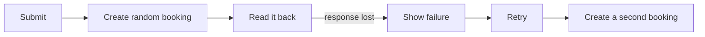
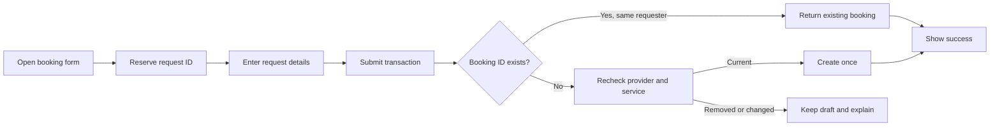

# Retry-safe booking creation

## Why this changed

Previously, each submission generated a new Firestore booking ID and then read the document back. A successful write followed by a lost response could look like a failure. Pressing **Submit** again created a second booking.

## What happens now

The screen reserves one random request ID without writing anything. Every retry from that screen reuses it. A Firestore transaction checks for that ID, revalidates the current public provider and selected service, and creates the booking only when it does not already exist.

The price remains a requester-proposed CFA amount. It is a positive bounded integer, while the provider and selected published service are authoritative and must still exist when the request is submitted.

## Security and reliability boundaries

- `creationRequestId` must equal the Firestore booking document ID.
- Only the signed-in requester can create the booking, and self-booking remains denied.
- The provider must be public and the selected service must still belong to that provider.
- Rapid double taps are blocked before React can rerender the disabled button.
- A lost acknowledgement can be retried with the same ID and cannot create another booking.
- Expected stale-service failures use localized English and French messages; unexpected network failures keep the form intact and explicitly say retrying is safe.

## Verification and rollout

Verified locally with TypeScript, focused ESLint, and the complete Auth/Firestore emulator suite. Emulator coverage includes a valid create, request/document ID mismatch denial, stale and malformed payload denial, and an idempotent retry that cannot overwrite the original request.

This changes the required create schema. After the PR is merged, publish the Firestore rules and then verify one real requester-to-provider booking on the merged mobile client. Do not deploy these rules before the compatible client is available, because an older client does not send `creationRequestId`.
