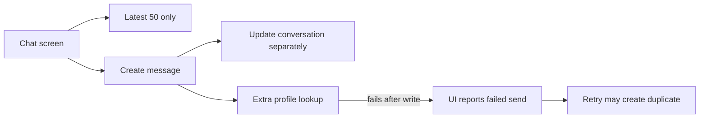
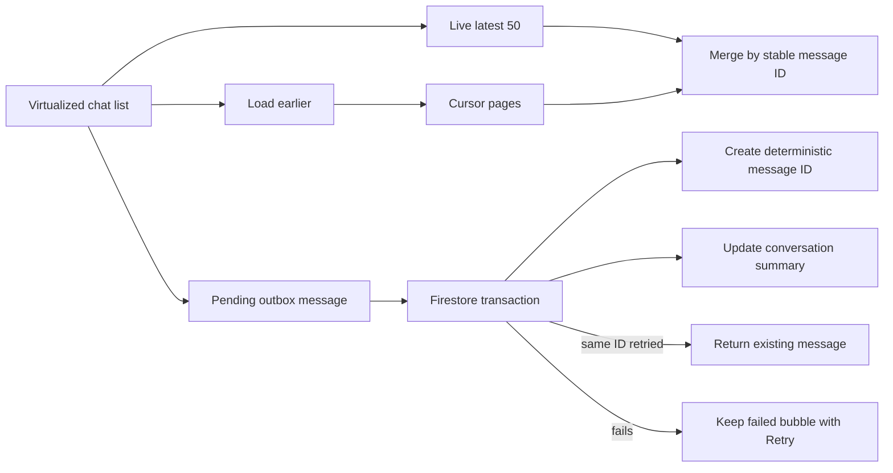

# Reliable message history and sending

## Why this changed

The chat previously listened only to the latest 50 messages. There was no way to read anything older, and a send could be committed to Firestore but still appear to fail if later display-data work failed. Retrying such a send could create a duplicate. Incoming messages could also pull someone away from older history they were reading.

## Before



## After



## User experience

- “Load earlier messages” retrieves history without jumping the list.
- A new incoming message does not force-scroll someone reading older messages; a **New message** button appears instead.
- Outgoing messages visibly move through sending, sent, or failed states. Failed messages remain available for retry.
- Retrying uses the same message identity, so an uncertain network response cannot create a duplicate.
- A newer draft in the composer is never replaced when an older send fails.
- Chat controls have localized English/French accessibility labels and 44-point touch targets.

## Data and security

The Firestore shape is unchanged:

```text
conversations/{conversationId}
└── messages/{stableMessageId}
```

Creating the message and updating the parent conversation summary now happen in one transaction. Existing Firestore rules already require the authenticated participant, valid message fields, and a matching parent summary update, so this work needs no rule deployment or data migration.

## Verification

- TypeScript check passed.
- Focused lint passed with no warnings or errors.
- Full Auth/Firestore emulator suite passed, including authorized cursor traversal across more than 100 messages and idempotent retry of the same message ID.
- Android production bundle export passed.
- iPhone 15 / iOS 17.5 live smoke test sent a real message, reloaded the app, and confirmed it persisted exactly once in both the conversation list and chat.

No native dependency changed, so this work does not require new iOS or Android EAS builds.
